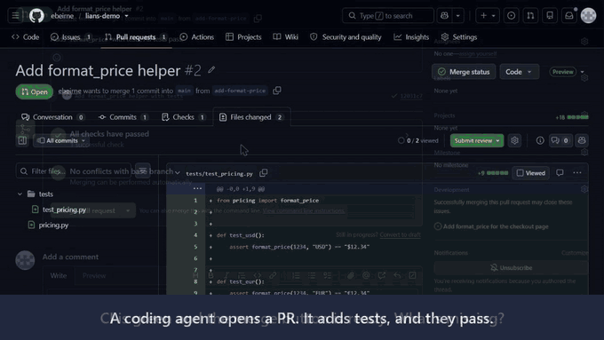

# Lians check

[](https://github.com/marketplace/actions/lians-check)

Agent PRs pass CI and still miss the ticket. Lians posts one comment per PR: every requirement in the linked ticket marked met, missed, partly done, or changed since the agent started.

Keep your code reviewer. This checks the ticket, and re-checks every open PR when the ticket is edited. Free for everyone through January 31, 2027, and free for open-source repos after that. Install the GitHub App in two clicks, or run the Action in your own GitHub Actions on your own Anthropic key (about $0.10–0.30 a review), with nothing sent to Lians.



That's a real run: [the actual PR](https://github.com/ebeirne/lians-demo/pull/2) · [full 51-second video](https://www.lians.ai/#demo) · How often agent PRs miss the ticket: [the study](https://www.lians.ai/agent-prs)

## Free for open source

Maintainers: **Lians stays free for public repos under an OSI-approved open-source license.** That holds after January 31, 2027, when free use ends for everyone else. No sales call and no card.

If you're getting agent PRs from contributors, this shows you what each one left undone before you review it. [Install it in two clicks](https://www.lians.ai/install), or [try it on a sample repo](https://github.com/ebeirne/lians-check-starter) first.

## Install

**Try it first:** [the starter repo](https://github.com/ebeirne/lians-check-starter) has a sample ticket and an agent PR, so you can watch a real check in about 2 minutes.

**Easiest: [install the GitHub App](https://www.lians.ai/install).** Two clicks, no workflow file, no API key. The diff and ticket pass through Lians to Anthropic and aren't stored.

**Or run the Action** in your own CI on your own key, with nothing sent to Lians:

**Fastest:** one command opens a setup PR in your repo (uses your `gh` login):

```bash
curl -sLO https://raw.githubusercontent.com/ebeirne/lians-check/v1/lians_check.py
python lians_check.py --init --repo your-org/your-repo
```

Then add a repository secret `ANTHROPIC_API_KEY` (the PR links straight to the page) and merge. Open a PR that says `Fixes #123`; the comment appears within a few minutes.

**By hand:** add the `ANTHROPIC_API_KEY` secret and this file as `.github/workflows/lians-check.yml`:

```yaml
name: Lians check
on:
  pull_request:
    types: [opened, synchronize, reopened, edited]
  issues:
    types: [edited]
permissions:
  contents: read        # read the diff and config files
  pull-requests: write  # post the one Lians comment
  issues: write         # read tickets; tag the PR author when a ticket changes
concurrency:
  group: lians-check-${{ github.event.pull_request.number || github.event.issue.number }}
  cancel-in-progress: true
jobs:
  check:
    runs-on: ubuntu-latest
    steps:
      - uses: ebeirne/lians-check@v1
        with:
          anthropic-api-key: ${{ secrets.ANTHROPIC_API_KEY }}
```

**Safe defaults:** informational only (it never fails your build unless you set `fail-on-missed: "true"`); one comment per PR, updated in place; skips PRs from forks (they get no secrets); skips lock files, minified bundles and binaries; only grades issues the PR says it closes; treats the ticket author's and maintainers' comments as the current scope. If the key is missing, it posts a one-line setup note instead of failing. For supply-chain safety you can pin `uses: ebeirne/lians-check@<commit-sha>` instead of `@v1`.

Optional inputs: `linear-api-key` (read-only, to check Linear tickets named in the PR title, branch or body),
`fail-on-missed: "true"` to fail the check when a requirement is missed.

## Jira

Add three inputs and Lians checks Jira issues named in the PR title, branch or body (for example `ROB-142`). Jira keeps every earlier version of the description, so Lians knows exactly what the ticket said when work started.

```yaml
      - uses: ebeirne/lians-check@v1
        with:
          anthropic-api-key: ${{ secrets.ANTHROPIC_API_KEY }}
          jira-base-url: https://acme.atlassian.net
          jira-email: ${{ secrets.JIRA_EMAIL }}
          jira-api-token: ${{ secrets.JIRA_API_TOKEN }}
```

## When the ticket changes

Keep `issues: types: [edited]` in the workflow. When someone edits a ticket, Lians re-checks every open PR that closes it. If the PR no longer covers the new version, it posts a short new comment tagging the PR's author with the requirements that now need a look, so the change can't slip past whoever (or whatever agent) is working on it.

## Robot code: parameters, launch files and URDFs

In ROS-style repos (anything with a `package.xml`), Lians also reads the parameter YAMLs, launch files and robot descriptions at the PR's head commit, not just the diff. A ticket that says "cap joint velocity at 1.2 rad/s" is checked against the value actually in `config/*.yaml`, even when the PR didn't touch that file. Set `robot-context: off` to check the diff only.

## Traceability record

Every check stores its result in the PR comment. Run Lians in `export` mode to get one CSV row per requirement per PR (ticket, requirement, status, evidence, PR, commit, date) plus a readable Markdown report, uploaded as the `lians-trace` artifact. It's the record a safety review or audit asks for: which requirement was built where, with what evidence.

```yaml
name: Lians traceability export
on: workflow_dispatch
permissions:
  contents: read
  pull-requests: read
  issues: read
jobs:
  export:
    runs-on: ubuntu-latest
    steps:
      - uses: ebeirne/lians-check@v1
        with:
          mode: export
```

## Keep code inside your AWS (Amazon Bedrock, including GovCloud)

For export-controlled or regulated code, run Claude through your own Amazon Bedrock instead of the Anthropic API.
The diff then goes only to Bedrock in your AWS account and region, including AWS GovCloud (US). No Anthropic key
is needed. Give the workflow `id-token: write` and replace the step with:

```yaml
    steps:
      - uses: aws-actions/configure-aws-credentials@v4
        with:
          role-to-assume: arn:aws-us-gov:iam::123456789012:role/lians-bedrock   # a role allowed to call bedrock:InvokeModel
          aws-region: us-gov-west-1
      - uses: ebeirne/lians-check@v1
        with:
          bedrock-model: <the Claude model ID or inference profile enabled in your Bedrock account>
```

Bedrock calls are billed by AWS to your account. Lians itself never sees your code.

## What it will and won't say

Lians only grades issues the PR says it closes. It treats the ticket author's and maintainers' latest comments as
the current scope, and it says "can't tell" rather than "missed" when the work could live outside the diff or
the PR says it was done elsewhere. It does not review code quality; it answers one question: does this PR do
what the ticket asks?

## Troubleshooting

- **"No Claude API key, so Lians skipped this run"** (warning): the `ANTHROPIC_API_KEY` secret is missing or isn't
  passed as `anthropic-api-key`. Add it under Settings → Secrets and variables → Actions. PRs that link a ticket
  also get a short setup comment.
- **"Anthropic rejected the ANTHROPIC_API_KEY secret (401/403)"** (error): the key is wrong, revoked or has no API
  access. Replace the secret and re-run the job. Lians never prints the key and posts no comment in this case.

Both exit successfully, so a missing key never blocks a merge.

## Pricing and license

Free for everyone through January 31, 2027, and free after that for public repositories under an OSI-approved open-source license. You pay only your own model usage. Teams that want help installing and tuning it can book a free install call: ethan.g.beirne@gmail.com.

Source-available under the Lians Check License 1.1 (see [LICENSE](LICENSE)).

Questions or noise reports: ethan.g.beirne@gmail.com
